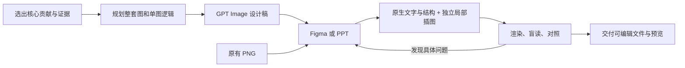

# Paper Figure Skill

**核心贡献 → GPT Image 设计稿 → Figma / PPT 可编辑重建 → 读者视角复查**



- 以图、机制和真实结果为主；主图只保留支撑核心 contribution 的内容。
- 人物、物体和复杂场景可以保留 GPT Image 位图；标签、模块和连接关系可编辑。
- 新图允许规划和删减；复刻原 PNG 保持原布局，逐块对照。
- 完整绘图 / 复刻默认至少 5 轮检查修正；次数不代替质量。

## 使用

将 `research-figure/` 复制到所用 agent 的 skills 目录。Codex 示例：

```bash
git clone https://github.com/newsun-boki/Paper-Figure-Skill.git
cd Paper-Figure-Skill
mkdir -p "${CODEX_HOME:-$HOME/.codex}/skills"
cp -R research-figure "${CODEX_HOME:-$HOME/.codex}/skills/"
```

```text
使用 $research-figure，把这篇论文的核心贡献规划成方法图。
先用 GPT Image 生成，再重建到 PowerPoint；局部插图保留位图。
```

```text
使用 $research-figure，从这张 PNG 忠实复刻到 Figma，
不要重新设计。反复检查文字、箭头、位置和读者理解。
```

需要当前环境有图像生成及相应编辑工具。仅对照脚本依赖 Pillow；本 skill 不内置付费 API、不存储密钥。原生重建由当前环境的 Figma / presentations 能力执行。

[Skill 正文](research-figure/SKILL.md) · [来源与取舍](research-figure/references/sources.md)

整体规划参考彭思达公开科研笔记及其 skills 整理版；混合重建与读者检查流程按实际需求独立编写。发布包不包含用户论文、原图或私有项目内容。
